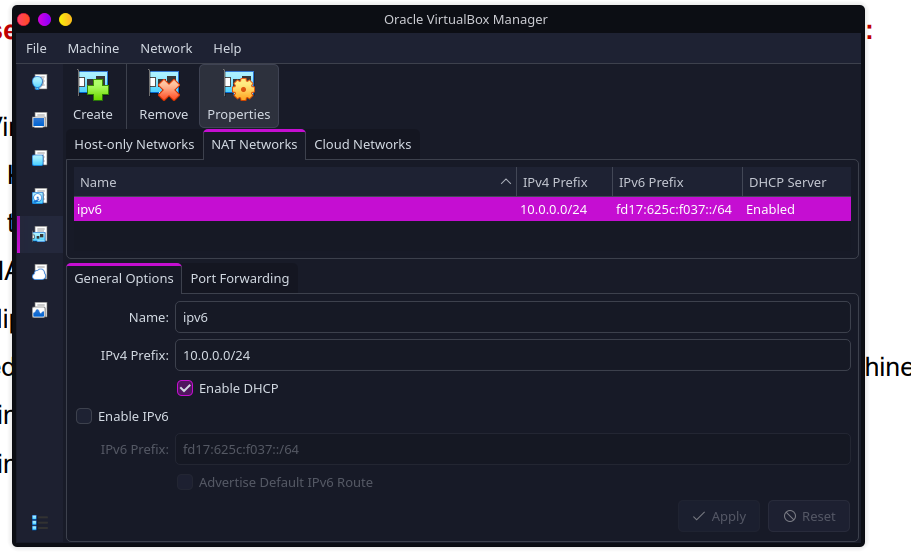
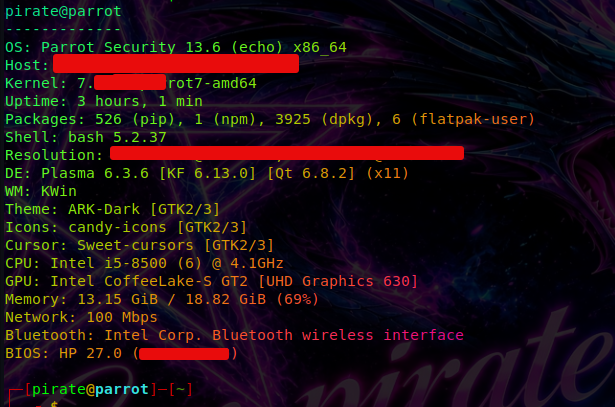
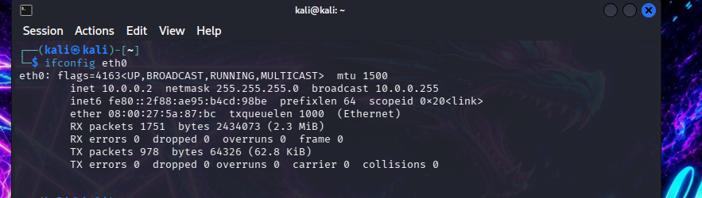
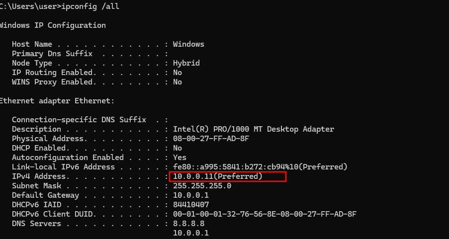
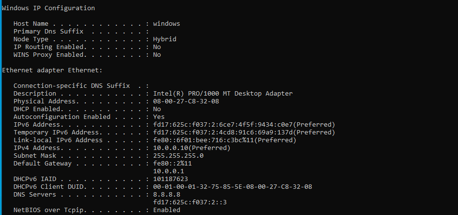
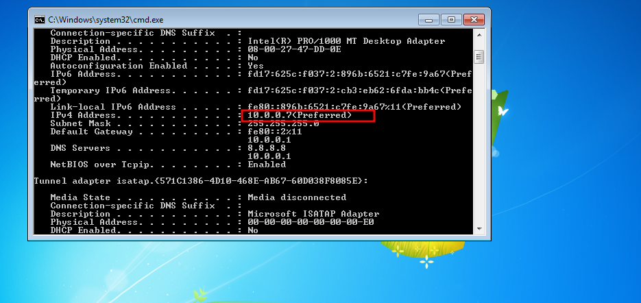

# Week 1 Project --- Cybersecurity Lab Setup
### Author <br>
---


## 1. Project Overview

This project documents the setup of a virtual cybersecurity testing
environment using **Oracle VM VirtualBox** and **Kali Linux**. The
environment provides an isolated virtual network for cybersecurity and
ethical-hacking practice while allowing the Kali Linux virtual machine
to access the internet.

The Week 1 deliverable focuses on preparing the host virtualization
platform, creating the required NAT Network, importing Kali Linux,
configuring its network address, enabling host--guest integration
features, and saving a clean virtual-machine snapshot.

> **Scope:** This README follows the Week 1 project brief. Additional
> target virtual machines, such as Windows and Android, are optional
> future-lab activities and are not required for the core Week 1 setup.
> However, _windows 10, windows 11 and windows 7_ were installed and the IP allocation done as per the request
in the lab manual

## 2. Project Objectives

-   Install and use VirtualBox as the virtualization platform.
-   Create a VirtualBox **NAT Network** using the `10.0.0.0/24` subnet as indicated in the screenshot [Here](./screenshots/overall_addressing.png)
-   Import and configure Kali Linux as the attacker/testing machine.
-   Assign Kali Linux the static IPv4 address `10.0.0.2`.
- Windows 11 was assignmed the address `10.0.0.11`
- Windows 10 was assignmed the address `10.0.0.10`
- Windows 7 was assignmed the address `10.0.0.7`
-   Provide Kali Linux with internet access.
-   Enable clipboard sharing and drag-and-drop between the host and Kali
    Linux.
-   Configure a shared folder that maps the host's `/downloads` folder
    into the virtual machine.
-   Take a snapshot of the configured Kali Linux virtual machine.

## 3. Lab Architecture

The host computer runs VirtualBox. Kali Linux runs as a guest virtual
machine connected to the custom NAT Network.

``` text
                    Host Computer
                  (Main OS(ParrotSec))
                          |
                    Oracle VirtualBox
                          |
                 Custom NAT Network
                    10.0.0.0/24
                          |
                    Kali Linux VM
                 Static IP: 10.0.0.2/24
                 Role: Attacker / Tester
                          |
                    Internet Access
```

### Network configuration

  Component                 Required configuration
  ------------------------- -----------------------------
  Virtual network type      NAT Network
  Network address           `10.0.0.0/24`
  Kali Linux IPv4 address   `10.0.0.2`
  Kali Linux role           Attacker / testing machine
  Internet access           Required
  Other virtual machines    Windows 10, Windows 11 and Windows 7 which were optional.
  They each had the IP addresses:
  - 10.0.0.11 for windows 11
  - 10.0.0.10 for windows 10
  - 10.0.0.7 for windows 7

The project brief illustrates a static/address range of
`10.0.0.0/24` for the NAT Network ensuring that the IP addresses assigned static
and do not conflict with an address already in use by another
virtual machine.The screenshot below shows shows the address ranges as 
configured in VirtualBox

[Image showing the address allocation](./screenshots/overall_addressing.png)

## 4. Host Computer Requirements

The project document gives the following recommended host
specifications. They are recommendations, not mandatory minimums.

  Resource    Recommended specification
  ----------- --------------------------------
  Memory      8 GB RAM or more
  Storage     256 GB SSD or more
  Processor   Intel Core i3/i5 or equivalent

Available resources should be considered before assigning CPU, RAM, and
storage to virtual machines.
The screenshot below shows some of the host machine specifications.

[Host Machine](./screenshots/host.png)

## 5. Software and Downloads

Install or obtain the following:

  ------------------------------------------------------------------------------------------------------------------------
  Software                Purpose                 Official download
  ----------------------- ----------------------- ------------------------------------------------------------------------
  7-Zip                   Extract downloaded      [7-zip.org/download.html](https://7-zip.org/download.html)
                          archives where required 

  Oracle VM VirtualBox    Run and manage virtual  [virtualbox.org/wiki/Downloads](https://virtualbox.org/wiki/Downloads)
                          machines                

  Kali Linux              Attacker/testing        [kali.org/get-kali](https://kali.org/get-kali)
                          operating system        
  ------------------------------------------------------------------------------------------------------------------------

Use the VirtualBox and Kali Linux versions recommended by the project
instructor or the relevant official download pages.

## 6. Implementation Procedure

### Phase 1 --- Core Week 1 setup

#### Step 1: Install 7-Zip

Download and install 7-Zip if it is needed to extract the Kali Linux
virtual-machine archive.

#### Step 2: Install VirtualBox

Download and install Oracle VM VirtualBox on the host computer.

#### Step 3: Create the NAT Network

In VirtualBox, create a custom NAT Network with the following network:

-   Network type: **NAT Network**
-   IPv4 network: `10.0.0.0/24`
-   Address range illustrated in the brief: `10.0.0/24`

Save the network configuration and attach the Kali Linux virtual machine
to this NAT Network.

#### Step 4: Download and import Kali Linux

Download the Kali Linux VirtualBox image from the official Kali website.
Extract the archive if necessary, then import/open the virtual machine
in VirtualBox according to the image format supplied.

#### Step 5: Configure the Kali Linux virtual machine

Configure the virtual machine's network adapter to use the custom NAT
Network created in Step 3.

Enable the following integration features in the virtual-machine
settings:

-   Shared Clipboard
-   Drag and Drop
-   Shared Folder

Configure the host folder named `/downloads` as the shared folder for
the Kali Linux virtual machine. Confirm the actual host path and
shared-folder settings in VirtualBox.

#### Step 6: Configure Kali Linux networking

Configure Kali Linux with the static IPv4 address:

[Kali Linux Virtual Machine IP configuration](./screenshots/Kali.png)

``` text
IP address: 10.0.0.2
Subnet mask: 255.255.255.0
CIDR:        /24
```

The project requires full internet access from Kali Linux. The brief's
network-settings illustration notes that `10.0.0.1` may be used if
internet connectivity gives issues. Confirm the correct gateway and DNS
values against the actual VirtualBox NAT Network configuration rather
than assuming values that are not shown in the brief.

#### Step 7: Take a virtual-machine snapshot

After the operating system, network, and integration settings have been
configured and tested, take a VirtualBox snapshot.

Give the snapshot a descriptive name, for example:

``` text
Week 1 - Clean Kali Lab Setup
```

The snapshot provides a known setup state to return to before later lab
exercises.

### Phase 2 --- Optional future lab expansion

The project document identifies this phase as optional and intended for
future tasks.

1.  Download and install additional virtual machines such as Windows 11,
    Windows 10, Windows 7, or Android 9.x, as required by later
    exercises.
2.  Connect each additional virtual machine to the same NAT Network
    where appropriate.
3.  Assign each machine a suitable address in the `10.0.0.0/24` subnet,
    ensuring there are no duplicate IP addresses.
4.  Perform ping tests between the virtual machines.
5.  Take snapshots of the additional virtual machines.
The project diagrams below also illustrates example addresses for optional
machines. These are examples in the lab architecture, not additional
Week 1 requirements.


 

[Windows 11 Screenshot showing the static IP address](./screenshots/Windows11.png)



[Windows 11 Screenshot indicating the static IP address](./screenshots/windows10.png)



[Windows 11 Screenshot indicating the static IP address](./screenshots/Windows7.png)
## 7. Configuration and Verification Checklist

Use this checklist to record whether the required setup has been
completed.

-   [ ] 7-Zip installed, if required.
-   [ ] VirtualBox installed.
-   [ ] Custom NAT Network created.
-   [ ] NAT Network configured for `10.0.0.0/24`.
-   [ ] Kali Linux virtual machine imported.
-   [ ] Kali network adapter attached to the custom NAT Network.
-   [ ] Kali IPv4 address configured as `10.0.0.2/24`.
-   [ ] Kali Linux has internet access.
-   [ ] Shared Clipboard enabled.
-   [ ] Drag and Drop enabled.
-   [ ] Host `/downloads` folder configured as a shared folder.
-   [ ] Kali Linux setup snapshot created.

### Suggested verification commands

Run these commands inside Kali Linux to inspect the network
configuration and test connectivity:

``` bash
ip -4 address
ip route
```

Test connectivity to an internet IP address:

``` bash
ping -c 4 8.8.8.8
```

Test DNS resolution:

``` bash
ping -c 4 google.com
```

A successful IP-address test but failed domain-name test may indicate a
DNS configuration issue. These commands are practical verification
checks; the project brief does not prescribe specific test commands.

## 8. Troubleshooting --- Kali Linux Has No Internet

The project brief recommends checking the following:

1.  Confirm that the NAT Network was created correctly.
2.  Recheck the VirtualBox network settings for the Kali Linux virtual
    machine.
3.  Confirm that no other virtual machine on the same NAT Network is
    using `10.0.0.2`.
4.  Restart the relevant virtual machines and, if necessary, the host
    operating system.
5.  If the issue persists on VirtualBox 7 with Kali Linux 2026.1 or
    newer, try the NetworkManager commands below, as specified in the
    project document.

``` bash
sudo nmcli connection modify "Wired connection 1" ipv4.dad-timeout 0
sudo nmcli connection down "Wired connection 1"
sudo nmcli connection up "Wired connection 1"
```

After applying the commands, recheck the network configuration and
internet connectivity. The connection name shown above must match the
connection name on the Kali system.

## 9. Expected Outcome

At the end of the core Week 1 project, the host computer should have
VirtualBox installed and a working Kali Linux virtual machine connected
to a custom NAT Network.

The Kali Linux virtual machine should meet these required conditions:

-   It uses the `10.0.0.0/24` NAT Network.
-   It has the static address `10.0.0.2`.
-   It has internet access.
-   Shared Clipboard and Drag and Drop are enabled.
-   The host `/downloads` folder is configured as a shared folder.
-   A snapshot of the configured virtual machine has been saved.
- Optional Windows 7, 10 and windows 11 virtual machine installed.

## 10. Responsible Use

This environment is intended for authorized cybersecurity education,
ethical-hacking practice, and controlled lab exercises. Only test
systems and networks that you own or have explicit permission to assess.
Keep practice activities within the intended lab scope.

## 11. References

The following official resources are identified in the project brief:

-   [7-Zip Downloads](https://7-zip.org/download.html)
-   [Oracle VM VirtualBox
    Downloads](https://virtualbox.org/wiki/Downloads)
-   [Kali Linux --- Get Kali](https://kali.org/get-kali)
-   [Windows Operating systems](microsoft.com)

**Project reference:**
`WK1-PM1 — Week 1 — Project Module 1: Lab Setup VirtualBox and Kali Linux, Version 4.2`
(Networkwalks).

------------------------------------------------------------------------

*Week 1 Project --- Cybersecurity Testing Lab Environment*
