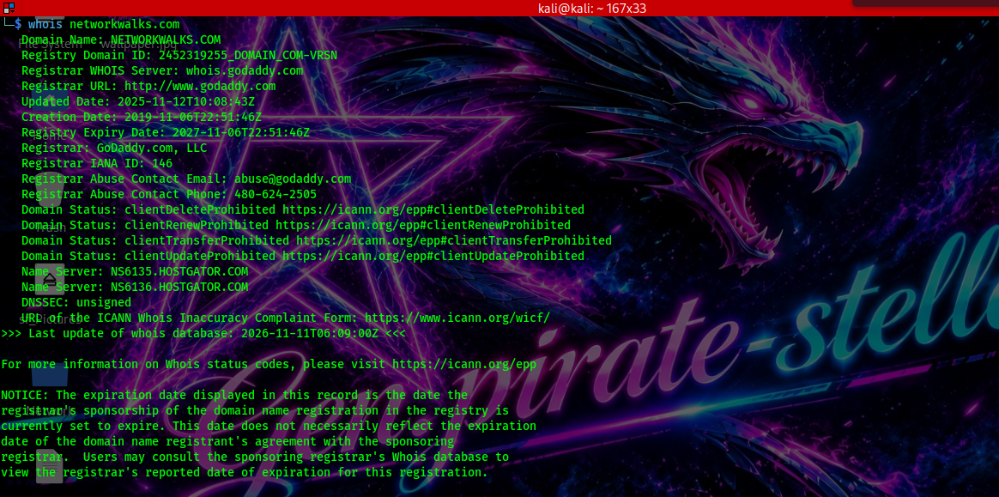
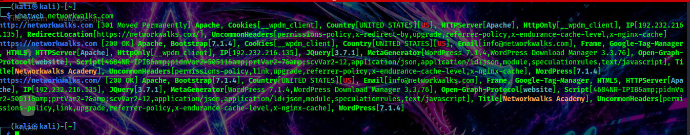
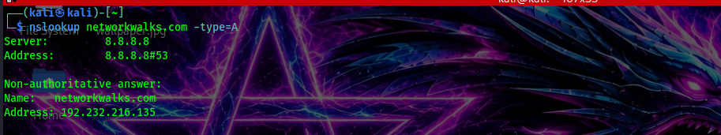
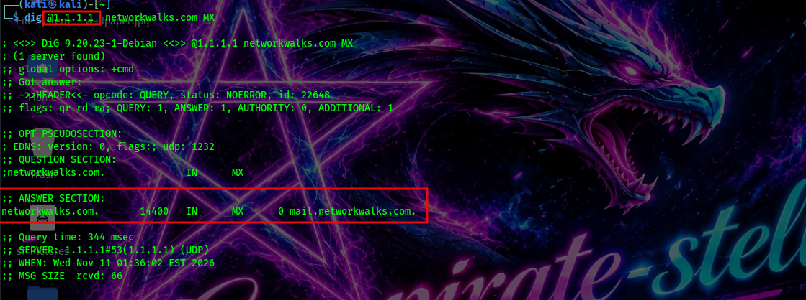
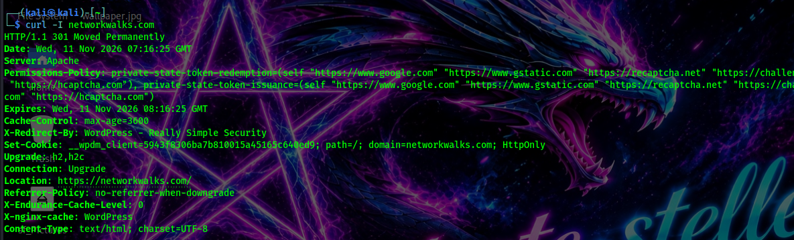
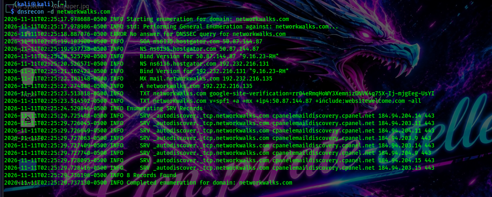
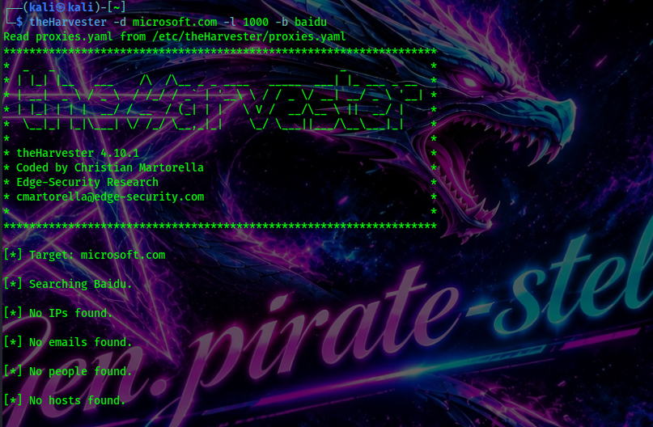
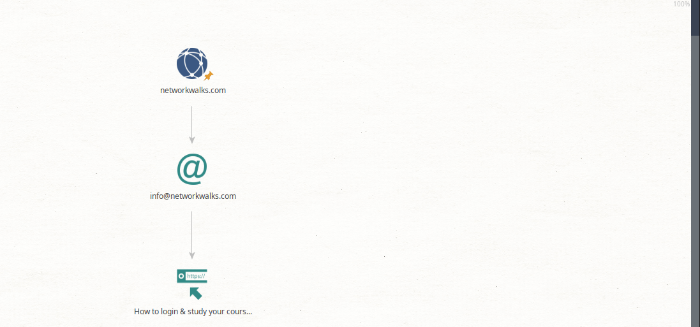
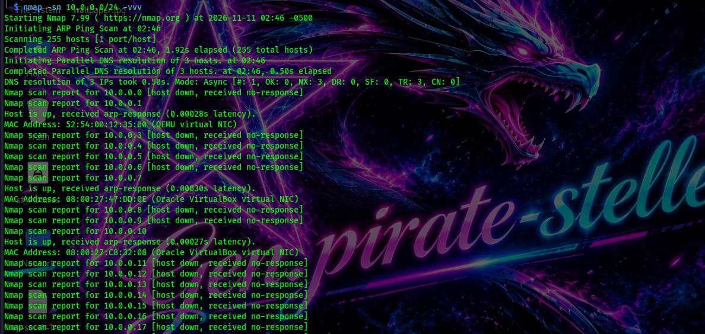
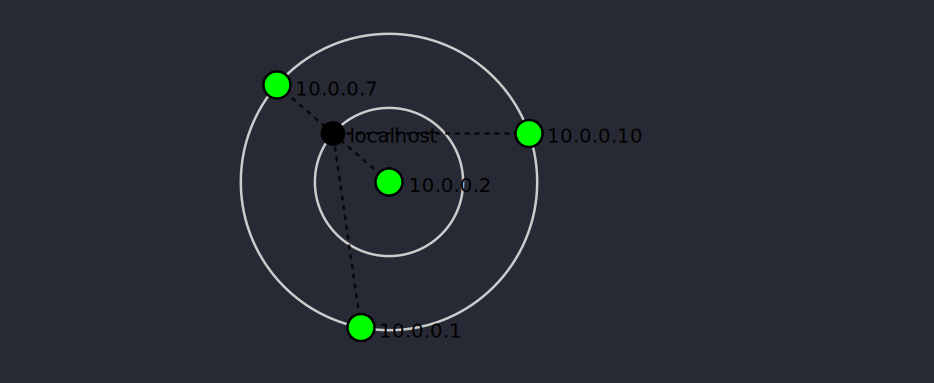

# PENETRATION TESTING REPORT
### FOOTPRINTING & NETWORK SCANNING PHASES

W2-PM-FINAL | CYBERSECURITY | NETWORKWALKS

 <br>
 <br>
 <br>
 <br>
 

| **Client/Target**|
|---|
| - Networkwalks (With Permission)|
| - Lab Network (Owned By Me) |


| **Modules Completed:** |
|---|
| - W2-PM1 (information ) |
| - W2-PM5 (Zenmap/Nmap Scanning) |

| **Phases Covered:** |
|---| 
| - **Phase 1**: Reconnaissance & Footprinting|
| - **Phase 2:** Scanning and Hosts Discovery|
| - **Phase 3:** In Progress | 

>Disclaimer:
_I have performed these activities only on the systems & devices where I had secured written permission or the devices/systems that I own myself. All these materials are for education and research purpose only. Do not use anything from here to break the law. The instructor, the authors and Networkwalks are not responsible for what you do with this knowledge. Every action you take is your own responsibility. Misuse can lead to criminal charges, heavy fines, loss of your job and a permanent record. In most countries unauthorised access is a crime even when nothing is damaged._
# Executive Summary
### Purpose &amp; Scope
This report documents the practical activities required for Week 2. These activites include the reconnaissance of networkwalks.com domain, host discovery using zenmap. Together, they show how an attacker collects information from their target upto the point they are able to know the most valuable target to attack. This lab activity requires us to choose one task from section I of the lab manual but in this case, we will be performing all the tasks so that we can gather a lot of information as we can.
### Key Findings
The key findings are summarised as:
- The site runs on wordpress
- the domain [https://networkwalks.com](https://networkwalks.com) resolves to the IP _192.232.216.135_
- the nameservers point to hostgator nameservers
- the domain registrar is https://www.godaddy.com
- DNSSEC is not signed
- the website runs on wordpress 7.1.4 cms on an Apache server 
- The website is behind **ModSecurity WAF**
### Network Scanning 
- The scanning was to be done using Zenmap which is a GUI tool for **nmap**. However, in this case, we will use both tools so that we can clearly be able to map the infrastructure clearly.A ping scan of the network **10.0.0.0/24** was done and **_** hosts discovered to be up.Their MAC addresses were also displayed and recorded.The discovered live hosts were:
- 10.0.0.1
- 10.0.0.2
- 10.0.0.7
- 10.0.0.10
### Risk Assessment
From the results, the overall risk rating is medium as the information presented contained the Server IP, HTTP headers and WAF Identification.However, fingerprinting the website CMS version as Wordpress 7.1.4 and its plugin could lead to potential danger as attackers might craft zero days which might work on the website.
### Recommendations
Even though the risks assessment is medium, We recommend the following actions to be taken to reduce the risks rating from medium to low.
- reduce publicly visible technology and HTTP header information
- Keep wordpress plugin updates
- Review DNS records periodically
- Regularly scan internal networks to view unidentified hosts
### Conclusion
This activity shows that a lot of information can be gathered from the public domain and network responses before any act of exploitation is attempted. The next phases in this activity will be able to determine if the services and the versions running on all the four hosts can be determined and if they have any vulnerability presented out to the attacker

# Introduction
Reconnaissance is the first stage of any security assessment or any attack depending on the type of security testing is done. Before the attacker moves on to exploitation, they use this stage to collect a lot of information on the target as they can using passive and active methods. This activities help an attacker understand what exists, which servers are online, the software versions they run and which devices are connected to the same network. 
This report covers two practical modules.  The first module **W2-PM1**, is a footprinting activity where reconnaissance was done against _networkwalks.com_ where written permission was explicitly granted for these purposes. This activity uses a variety of tools indicating that in any security assessment, there are a lot of tools available to the attacker and there is no any limit to the number of the tools uses to get any information on the target. The tools used in this recon phase are:
- WHOIS
- WhatWeb
- WafW00f
- Nslookup
- Curl
- DNSRecon

Each used is used to discover different kind of information on the target.

The second practical activity **W2-PM2** involves scanning the network using zenmap or nmap where the local IP address and the subnet are mapped assuming the attacker knows them before the engagement.A ping scan is ran to determine which hosts are available together with their MAC addresses. Zenmap helps generate the network topology map.

Overall, the two modules strengthen the reconnaissance skills and shows how information about the target is obtained from the public domain or actively engaging the target. This report captures the commands used for easier reproduction and an explanation of why the findings matter in a security point of view. The findings are assessed of risks which are then followed by recommendations so that the risks can be mitigated. All the activities in this lab were performed in test environment and on live systems, permission was granted. As set out in the liability disclaimer. All the activities recorded were done for educational purposes and no liability of illegal use of the commands contained in this document will be accepted.

## Activity Objective
The objectives of the penetration test were:
- Gather publicly available information on the target
- fingerprint web technologies used to create the clients website
- Discover the domain nameservers and their DNS records
- Determine whether the website was behind a Web application firewall 
- Scan and map the network devices in the local subnet
- Discover live hosts
- Assess the risks of the information exposed
- Practice authorised and ethical testing bound by the scope of the permission document.

# Tools and Resources Used
| *Tool* | Purpose |
|---|---|
|Kali Linux| An Operating system build for security testing|
|WHOIS| Used to find domain ownership details|
|WhatWeb| Designed to fingerprint the websites technology|
|nslookup|used to display websites DNS records|
|curl|used to read HTTP responses & headers from the terminal|
|wafw00f|detects if a website is behind a firewall|
|dnsrecon|Enumerates all the DNS records|
|Zenmap|Scans the network for hosts & services (GUI version)|
|Nmap|Scans the network for hosts & services (CLI version)|

# Methodologies
The steps to uncover the publicly available information on the target followed a structured aproach which was done one after the other using the tools provided earlier. After the public information has been recorded, another step into hosts discovery in the network was done to determine live hosts in the network so that the attacks could be escalated further focusing on the live hosts. These steps are outlined below.
### Footprinting & Reconnaissance
The information gathering was performed on the domain _networkwalks.com_ where permission was explicitly granted. The tools used are recorded below with their results as displayed. It should be noted that the results are shown in form of a screenshot. In cases where the response could not fit in a single screenshot, only the essential sections are shown.
##### 1. WHOIS
This tool enumerates domain ownership details for a targeted domain. In this case, the domain to be enumerated was _networkwalks.com_ where the command below was used.
```bash 
whois networkwalks.com
```
The response from the command can be summarized as seen in the image below.

[Image showing the results of whois tool on domain networkwalks.com](./Screenshots/whois.png)
```text
Domain Name: NETWORKWALKS.COM
   Registry Domain ID: 2452319255_DOMAIN_COM-VRSN
   Registrar WHOIS Server: whois.godaddy.com
   Registrar URL: http://www.godaddy.com
   Updated Date: 2025-11-12T10:08:43Z
   Creation Date: 2019-11-06T22:51:46Z
   Registry Expiry Date: 2027-11-06T22:51:46Z
   Registrar: GoDaddy.com, LLC
   Registrar IANA ID: 146
   Registrar Abuse Contact Email: abuse@godaddy.com
   Registrar Abuse Contact Phone: 480-624-2505
   Domain Status: clientDeleteProhibited https://icann.org/epp#clientDeleteProhibited
   Domain Status: clientRenewProhibited https://icann.org/epp#clientRenewProhibited
   Domain Status: clientTransferProhibited https://icann.org/epp#clientTransferProhibited
   Domain Status: clientUpdateProhibited https://icann.org/epp#clientUpdateProhibited
   Name Server: NS6135.HOSTGATOR.COM
   Name Server: NS6136.HOSTGATOR.COM
   DNSSEC: unsigned
   URL of the ICANN Whois Inaccuracy Complaint Form: https://www.icann.org/wicf/
>>> Last update of whois database: 2026-11-11T06:09:00Z <<<

For more information on Whois status codes, please visit https://icann.org/epp

NOTICE: The expiration date displayed in this record is the date the
registrar's sponsorship of the domain name registration in the registry is
currently set to expire. This date does not necessarily reflect the expiration
date of the domain name registrant's agreement with the sponsoring
registrar.  Users may consult the sponsoring registrar's Whois database to
view the registrar's reported date of expiration for this registration.

TERMS OF USE: You are not authorized to access or query our Whois
database through the use of electronic processes that are high-volume and
automated except as reasonably necessary to register domain names or
modify existing registrations; the Data in VeriSign Global Registry
Services' ("VeriSign") Whois database is provided by VeriSign for
information purposes only, and to assist persons in obtaining information
about or related to a domain name registration record. VeriSign does not
guarantee its accuracy. By submitting a Whois query, you agree to abide
by the following terms of use: You agree that you may use this Data only
for lawful purposes and that under no circumstances will you use this Data
to: (1) allow, enable, or otherwise support the transmission of mass
unsolicited, commercial advertising or solicitations via e-mail, telephone,
or facsimile; or (2) enable high volume, automated, electronic processes
that apply to VeriSign (or its computer systems). The compilation,
repackaging, dissemination or other use of this Data is expressly
prohibited without the prior written consent of VeriSign. You agree not to
use electronic processes that are automated and high-volume to access or
query the Whois database except as reasonably necessary to register
domain names or modify existing registrations. VeriSign reserves the right
to restrict your access to the Whois database in its sole discretion to ensure
operational stability.  VeriSign may restrict or terminate your access to the
Whois database for failure to abide by these terms of use. VeriSign
reserves the right to modify these terms at any time.

The Registry database contains ONLY .COM, .NET, .EDU domains and
Registrars.
Domain Name: networkwalks.com
Registry Domain ID: 2452319255_DOMAIN_COM-VRSN
Registrar WHOIS Server: whois.godaddy.com
Registrar URL: https://www.godaddy.com
Updated Date: 2025-11-12T05:08:41Z
Creation Date: 2019-11-06T17:51:46Z
Registrar Registration Expiration Date: 2027-11-06T17:51:46Z
Registrar: GoDaddy.com, LLC
Registrar IANA ID: 146
Registrar Abuse Contact Email: abuse@godaddy.com
Registrar Abuse Contact Phone: +1.4806242505
Domain Status: clientTransferProhibited https://icann.org/epp#clientTransferProhibited
Domain Status: clientUpdateProhibited https://icann.org/epp#clientUpdateProhibited
Domain Status: clientRenewProhibited https://icann.org/epp#clientRenewProhibited
Domain Status: clientDeleteProhibited https://icann.org/epp#clientDeleteProhibited
Registry Registrant ID: Not Available From Registry
Registrant Name: Registration Private
Registrant Organization: Domains By Proxy, LLC
Registrant Street: DomainsByProxy.com
Registrant Street: 100 S. Mill Ave, Suite 1600
Registrant City: Tempe
Registrant State/Province: Arizona
Registrant Postal Code: 85281
Registrant Country: US
Registrant Phone: +1.4806242599
Registrant Phone Ext:
Registrant Fax: 
Registrant Fax Ext:
Registrant Email: https://www.godaddy.com/whois/results.aspx?domain=networkwalks.com&action=contactDomainOwner
Registry Tech ID: Not Available From Registry
Tech Name: Registration Private
Tech Organization: Domains By Proxy, LLC
Tech Street: DomainsByProxy.com
Tech Street: 100 S. Mill Ave, Suite 1600
Tech City: Tempe
Tech State/Province: Arizona
Tech Postal Code: 85281
Tech Country: US
Tech Phone: +1.4806242599
Tech Phone Ext:
Tech Fax: 
Tech Fax Ext:
Tech Email: https://www.godaddy.com/whois/results.aspx?domain=networkwalks.com&action=contactDomainOwner
Name Server: NS6135.HOSTGATOR.COM
Name Server: NS6136.HOSTGATOR.COM
Name Server: NS29.DOMAINCONTROL.COM
Name Server: NS30.DOMAINCONTROL.COM
DNSSEC: unsigned
URL of the ICANN WHOIS Data Problem Reporting System: http://wdprs.internic.net/
>>> Last update of WHOIS database: 2026-11-11T06:09:09Z <<<
For more information on Whois status codes, please visit https://icann.org/epp

TERMS OF USE: The data contained in this registrar's Whois database, while believed by the
registrar to be reliable, is provided "as is" with no guarantee or warranties regarding its
accuracy. This information is provided for the sole purpose of assisting you in obtaining
information about domain name registration records. Any use of this data for any other purpose
is expressly forbidden without the prior written permission of this registrar. By submitting
an inquiry, you agree to these terms and limitations of warranty. In particular, you agree not
to use this data to allow, enable, or otherwise support the dissemination or collection of this
data, in part or in its entirety, for any purpose, such as transmission by e-mail, telephone,
postal mail, facsimile or other means of mass unsolicited, commercial advertising or solicitations
of any kind, including spam. You further agree not to use this data to enable high volume, automated
or robotic electronic processes designed to collect or compile this data for any purpose, including
mining this data for your own personal or commercial purposes. Failure to comply with these terms
may result in termination of access to the Whois database. These terms may be subject to modification
at any time without notice.

**NOTICE** This WHOIS server is being retired. Please use our RDAP service instead.

```
It is evident that the hosting provider, the nameservers and any other relevant information is obtained relating to the infrastructure is identified.

##### 2.Whatweb
This tool is used to fingerprint the technology used to create the website. The command used is 
```bash 
whatweb networkwalks.com
```
The results are as shown below where the mail stack is **PHP** which runs **wordpress** in an **Apache Server**. The details are shown in the screenshot below.
 
[A screenshot showing Whatweb response against networkwalks.com](./Screenshots/whatweb.png) 

#### 3. Nslookup
This tool is used to view DNS records of the web in question. For one view a specific record, one has to specify the type using the _-type_ flag. In the example below,one can view the **A** records using the command _nslookup -type=A networkwalks.com_ and the response will display the records as shown below.

The screenshot shows results including a non-authoritative answers meaning they are cached responses from a DNS server. However, more information can be gathered using **_dig_** which shows more information on the specific record required. One can also mask their own queries by specifying the server you want to query using the **@** symbol. An example, displaying **MX** records making my request appear to be originating from the server **1.1.1.1** would look like 
```bash 
dig @1.1.1.1 networkwalks.com MX
```
The results are as shown below with the server section and the results section highlighted respectively.

[A screenshot showing dig responses for A record for the target networkwalks.com](./Screenshots/dig.png)
> **Note**<br>
>- If no server is specified, the tool queries the _/etc/resolv.conf_ for the servers<br>
>- if no DNS records are specified, the tool queries for **A** record by default.

#### 4.Curl
This is a command line tool used in the terminal to make requests, inspect responses and audit the server information from the responses received. One of the protocols supported is HTTP which in this use case, it is used to determine the server serving HTTP responses. The command used is 
```bash 
curl -I networkwalks.com
```
The text response received in the terminal is as indicated below. 
The response is accompanied by a screenshot of it.
```text
HTTP/1.1 301 Moved Permanently
Date: Wed, 11 Nov 2026 07:16:25 GMT
Server: Apache
Permissions-Policy: private-state-token-redemption=(self "https://www.google.com" "https://www.gstatic.com" "https://recaptcha.net" "https://challenges.cloudflare.com" "https://hcaptcha.com"), private-state-token-issuance=(self "https://www.google.com" "https://www.gstatic.com" "https://recaptcha.net" "https://challenges.cloudflare.com" "https://hcaptcha.com")
Expires: Wed, 11 Nov 2026 08:16:25 GMT
Cache-Control: max-age=3600
X-Redirect-By: WordPress - Really Simple Security
Set-Cookie: __wpdm_client=5943f8306ba7b810015a45165c640ed9; path=/; domain=networkwalks.com; HttpOnly
Upgrade: h2,h2c
Connection: Upgrade
Location: https://networkwalks.com/
Referrer-Policy: no-referrer-when-downgrade
X-Endurance-Cache-Level: 0
X-nginx-cache: WordPress
Content-Type: text/html; charset=UTF-8
```

[Screenshot showing server response for networkwalks.com](./Screenshots/curl.png)

#### 5.wafw00f
This is a custom tool used to determine if the web application is behind a web application firewall. If there is the existence of the firewall, the firewall details are displayed. In this case, the command used is 
```bash 
wafw00f networkwalks.com
```
The response is as indicated below.

[A screenshot showing the response from wafw00f against networkwalks.com](./Screenshots/whatweb.png)

#### 6. DNSrecon
The tool is used to enumerate DNS records for a given domain. The command used in this case is 
```bash 
dnsrecon -d networkwalks.com
```
The response is summarised using the screenshot below.

[A screenshot showing the response from dnsrecon tool against networkwalks.com](./Screenshots/dnsrecon.png)
#### 7. The Harvester
This is an information gathering tool that allows us 'harvest' credentials from different platforms such as **LinkedIn, Baidu etc.**. The user details are fetched from **baidu** for an organization **microsoft**. The command used in this case is 
```bash 
theHarvester -d microsoft.com -l 1000 -b baidu
```

_-d_ specifies the domain


_-l_ specifies the limit 


_-b_ specifies the source of the records

The results of the commands are as shown below

[The Harvester showing the results of enumerating microsoft](./Screenshots/theHarvester.png)

It is clear that there is no identifiable information on any microsoft user in baidu platform.
>Note <br>
theHarvester requires API keys to operate. It might not worl as expected as the keys are not available.
#### 8. Google Hacking Database
The google hacking database is a collection of queries compiled to make google return the response that the user requires from an actual google search.Some information that might be disclosed is:
- camera feeds
- open directories
- login pages
- config files
- confidential documents among others.

Some of the queries used include:
- intitle
- inurl
- site
- intext among others
In this activity, we were required to find vulnerable cameras and downloadable mathematics books and fill them in the tables below.
##### GHDB Available camera links
|No.|Link|Relevant Command| Username/Password|
|---|---|---|---|
|1.|http://99.114.240.169:8080|intitle:"Webcam" inurl:WebCam.htm|None|
|2.|http://202.153.140.18:8106/|intitle:"IP CAMERA" "User Login" "User Name" "Password" "Preview Stream"| Not Available|
|3.|http://109.233.191.130:8080/|inurl:mobile.html intitle:webcamXP|N.A|
|4.|http://109.233.191.130:8080/mobile.html|inurl:mobile.html intitle:webcamXP|N/A|
|5.|http://75.149.26.30:1024/mobile.html|inurl:mobile.html intitle:webcamXP|None|
|6.|http://insecam.org/en/bytype/WebcamXP/?page=5|inurl:mobile.html intitle:webcamXP|None|
|7.|http://109.233.191.130:8080/multi.html|inurl:mobile.html intitle:webcamXP|None|
|8.|http://75.149.26.30:1024/|inurl:mobile.html intitle:webcamXP|None|
|9.|http://72.199.200.5:8080/|intitle:"webcamxp" "Flash JPEG Stream"|None|
|10.|http://139.64.168.120:8080/|intitle:"webcamxp" "Flash JPEG Stream"|None|

##### GHDB Links for downloadable links
|No.|Link|Relevant Command| Username/Password|
|---|---|---|---|
|1.|http://www.issp.ac.ru/ebooks/books/open/10070147.pdf|intitle: index of "parent directory" mathematics pdf|None|
|2.|https://www.chem.uci.edu/~unicorn/249/pdfs/|intitle: index of "parent directory" mathematics pdf|None|
|3.|http://erewhon.superkuh.com/library/Math/|intitle: index of "parent directory" mathematics pdf|None|
|1
4.|https://netlib.org/math/docpdf/|intitle: index of "parent directory" mathematics pdf|None|
|5.|https://www.jsoftware.com/books/pdf/|intitle: index of "parent directory" mathematics pdf|None|
|6.|https://mathflix.luc.edu/pdfs/Algebra/|intitle: index of "parent directory" mathematics pdf|None|
|7.|https://www.aetkin.com/files/Math%20150%20Calculus%20I/Advanced%20Calculus%20Textbook/|intitle: index of "parent directory" mathematics pdf|None|
|8.|https://lira.epac.to/DOCS-TECH/Math/Engineering%20and%20Applied/|intitle: index of "parent directory" mathematics pdf|None|
|9.|https://math.umd.edu/~immortal/206tutorial/|intitle: index of "parent directory" mathematics pdf|None|
|10.|https://englishbooks.com.tw/primary/|intitle: index of "parent directory" mathematics pdf|None|
#### 9. Maltego
This is an opensource tool used to link information from different sources.It helps investigators connect unrelated datapoints such as:
- Domain names
- IP Address
- Email Addresss among others.


In this case,Maltego was to extract email address from domain name *networkwalks.com* and the results were as shown below.

[Maltego stransforming the domain and extracting emails connected to the domain](./Screenshots/maltego.png)


At any point, a transformation has to be run against an entity which in this case, it is the **domain**. 
### NETWORK SCANNING
This activity is performed to map the infrastructure of the target. There might be two angles when scanning the system which are:
- The attacker has compromised the system and is scanning the local subnet 
- The attacker is trying to map out live hosts in the targets network. 


The second option is used here as we have no access to the actual client infrastructure. In this case, the scanning will be done in a network that we own where all the machines will be scanned. The subnet to scan was **10.0.0.0/24** which are in the same subnet as the **Kali Attacking Machine**.
The ping scan was done using **nmap** where only **4 hosts** were live in the entire subnet. They are seen from the screenshot below.

[A screenshot showing ping scan where live hosts were discovered](./Screenshots/nmap_ping_scan.png)

To clearly map the infrastructure, **Zenmap** was used so that a map of the hosts can be generated and the next phases planned properly.
The screenshot below shows the output of zenmap as seen from the Kali machine.

[A screenshot showing the live hosts in a subnet](./Screenshots/zenmap.png)

From the scans, it is determined that the following hosts are online.
- 10.0.0.7
- 10.0.0.1
- 10.0.0.2
- 10.0.0.10

However, it should be noted that **10.0.0.2** is the Kali Linux machine that is currently used as an attackbox.
> Note <br>
It is also expected that 10.0.0.11 would be online but due to some reasons, my windows 11 VM could not fire up during the time of the submission of the assignment.

## Risk Analysis and Impact
Based on the information gathered , the risks associated with the information gathered can be rated using the table below. 

|S/No|Risk|Evidence|Potential Impact|Risk Level|
|---|---|---|---|---|
|1.|Web Information Exposure|Identified wordpress version and plugins|Attackers might craft exploits for the specific version|Medium|
|2.|Identifiable Server IP address|As Mapped by _nslookup_|provides information about networking information giving attackers starting point to scan the network|low|
|3.|HTTP headers information|identified by Curl|assists in technoology fingerprinting|low|
|4.|WAF Identification|as Identified by wafw00f| WAF bypass payloads my be crafted as the version has been identified|low|
|5.|DNS information available|Identified by **DNSRecon, dig and nslookup**|Helps build a broder network map|medium|
|6.|Multiple Live hosts|Identified by nmap/zenmap|unauthorised devices might be inside the network|medium|

## Recommendations
- periodically review public information available to the users
- Always keep the CMS updated with its plugins 
- Always update the WAF and periodically confirm if its up and running 
- Review HTTP headers
- Review network devices even if they are whitelisted
- Always perform security testing on your infrastructure with permission.

## Conclusion
This penetration testing report covers the phases information gathering and scanning. In the footprinting activity, there was a lot of identifiable information in the public that made an attacker understand the target without interacting with it directly. The Google hacking database, Maltego and the harvester allowed us to collect as many Personal Identifying information as possible so that a juicy target can singled out for further attacks.
In the network scanning section, the live hosts and the network architecture was identified which helped us detect which other targets are connected to the network.
This activity show that information gathering is a crucial phase in any security test as one can only attack what they understand. The technical findings are well documented from the guidelines provided earlier as a good cybersecurity report should clearly document the findings, steps to reproduce, findings , risks ratings and ways to mitigate the risks.
It should be noted that any form of security engagement should be performed in an authorised environment where one has explicit permission or the one they own.