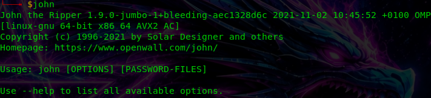
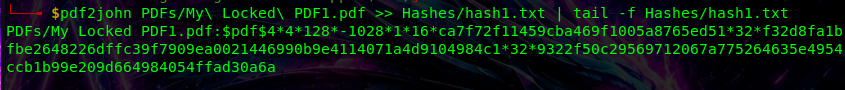
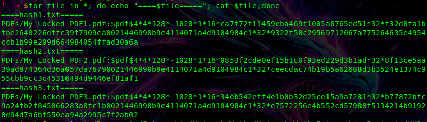
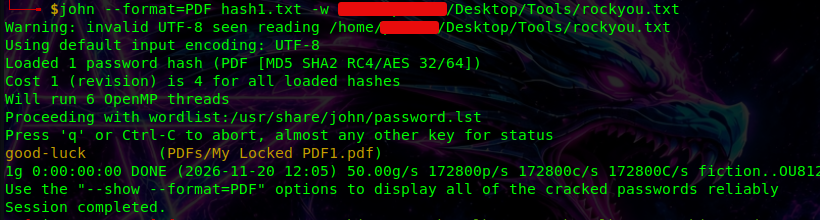
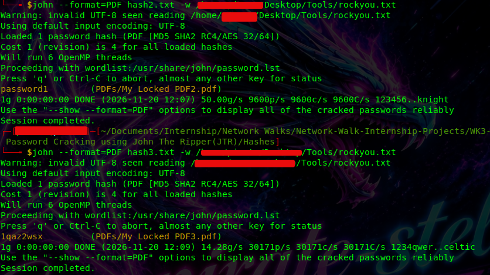

## Week 3 John the Ripper Assignment
WEEK 3 | Password Cracking | John The Ripper

 <br>
 <br>
 <br>
 <br>
# Executive Summary 
This lab activity is focused on understanding and practically demonstrating how passwords are recovered in an IT settings.The passwords are recovered so that the password protected documents can be read. Password protected documents are increasingly used in the industry to limit unauthorised access to confidential information in case the document falls into wrong hands.This exercise involved cracking a pdf password which is part of week 3 project module in **NetworkWalks** ethical hacking internship program.

The primary objective of this lab activity was to gain hands on skills required to audit passwords protecting organizations confidential document using tools such as **John the Ripper** which helps in extracting the passwords and assessing their strength.
This practical activity involved recovering passwords from password protected documents by first extracting the hash from the document which contains information required by john the ripper to recover the password.

Beyond password recovery and assessment, this activity provided insights between encryption, hashing and password security which shows that a document can also be subjected to offline password cracking stressing on the importance of a complex password that is not easily predictable.


In conclusion, the project showed the use of john the ripper to recover and assess password strength from a password protected documents. The knowledge and skills acquired here are foundational to the skills and techniques used in professional cybersecurity assessments.

# Introduction
Password security is a critical aspect of information security where critical information is protected from unauthorised access. This password protection applies to digital resources specifically documents where weak or less complex passwords are easier to crack compared to complex passwords. Password cracking is therefore essential for a cyber security professional so that they can help identify potential weak security links.

This project focuses on using John the Ripper to recover passwords from an encrypted pdf document. The recovery process required extracting the document hash, saving the hash and importing the hash to **john**  for password recovery.

Through this, the project allows us acquire practical skills in password recovery ranging from hash extraction to use of password tool in password cracking. This lab activity also highlights the importance of a complex password in protecting confidential data.

# Technical Summary
This project involved using password auditing tools:- John the ripper herein referred to as **john**. Although there are other tools such as **hashcat** that can be used to recover the password, our focus in this lab activity is with john. The technical implementation of how password assessment and recovery worked followed the following steps.

1. **Tool installation:** By default, the tool is already installed in Kali Linux and configured to run with the command **john** directly in the terminal.


2. Hash extraction from the pdf file

3. Hash preparation and storage in a hash.txt file

4. Hash importation to john

5. Password cracking where john runs the file hash against a wordlist and recovers the password.

6. Password verification where after successful cracking of the password, the password is tried to open the password protected document.

# Lab Objectives
The primary objectives of this lab activity was to equip the student with hands on skills to assess passwords using a password auditing and assessment tool.Other objectives include:

- generating file hashes from any file
- importing the file  hash into password auditing tool
- loading a password wordlist into the password auditing tool

# Tools and resources used
The tool required in this activity is john. It performs the activities of generating the file hash and running a password crack against the generated hash file.

# Methodology
The activities in this lab followed a structured approach outlined below. Each activity outlined followed one another sequentially and no single step was to be executed before another one. 

### installation of John the Ripper

John the ripper, is a free and open source password auditing tool by default installed in Kali Linux. In this case, this step is skipped as it is automatically installed. This can be verified using the command below in the terminal.
```bash 
john
```
If john is installed, the command returns the response as indicated in the screenshot below.

[A Screenshot showing john the ripper installed in parrot sec](./Screenshots/1.png)

### Pdf hash extraction
The pdf file hash was uploaded into an online hash generation platform provided by **Networkwalks** for this lab exercise. However, the hash could be extracted right from the terminal using the command 
```bash 
pdf2john <filename>
```
where the filename is the name of the file we want to crack the hash on.
In this case, the pdf files are three which are 
- [pdf 1](./PDFs/My%20Locked%20PDF1.pdf)
- [pdf 2](./PDFs/My%20Locked%20PDF2.pdf)
- [pdf 3](./PDFs/My%20Locked%20PDF3.pdf)

The hashes generated are as shown in the screenshots below.

**NOTE:** The screenshots indicate how the hashes are generated and stored in a file with a name corresponding to the pdf.
The hashes are generated using a command-line utility called **pdf2john**

[A screenshot showing hash generation using john](./Screenshots/2.png)

The other hashes were generated and stored in the **Hashes** directory as indicated below.

[A screenshot showing the files inside the Hashes Directory](./Screenshots/3.png)

The hashes can be displayed on the screen using a one liner bash script 
```bash 
for file in *; do echo "====$file====="; cat $file;done
```
The script gives the output as shown below.

[A screenshot showing the contents of the hash files](./Screenshots/4.png)

### hash importation
The hashes were imported into john ready for password cracking. The hashes were imported one after the other.
First, the format of the hash is determined using the command ```john --list=formats | grep -i pdf ``` where the pdf is used to filter the results out as the main file we are working on is a pdf. The response received is 
```bash 
john --list=formats | grep -i pdf
416 formatsPBKDF2-HMAC-SHA256, PBKDF2-HMAC-SHA512, PDF, PEM, pfx, pgpdisk, pgpsda, 
 (149 dynamic formats shown as just "dynamic_n" here)
 ```

 The screenshot below shows a single file hash1.txt imported into john using the command below.
```bash 
john --format=PDF hash1.txt 
```

The command above is repeated for all the other hashes.

### Password cracking
After the hash is loaded to john, a wordlist containing passwords is loaded so that john can compare the hash with a password in the file. For this activity, we will use the default **rockyou.txt** present in Kali Linux by default.


### Password verification
This activity is carried out after the password has been successfully retrieved. The content inside the documents can be revealed only after the password is correct.


# Findings
it is noted that the password cracking process was done fast  a clear indication that the password complexity was weak for the first document. John was able to get the password in under 10 seconds. The password retrieved was ```good-luck``` as indicated in the screenshot below.

[A Screenshot indicating how password recovering is done using john](./Screenshots/7.png)

Repeating the same process with hash2.txt and hash3.txt, the passwords were retrieved as ```password1``` and ```1qaz2wsx``` respectively.
The screenshot below combines the password cracking process as shown by john.

[A screenshot showing successful password recovery activity using john](./Screenshots/8.png)

# Results
The password recovery process went on smoothly and the passwords were tested against the file corresponding to the hash being cracked at a time. This activity showed that the passwords retrieved worked and the contents of the pdfs were successfully read .


[A screenshot showing the contents in pdf1](./Screenshots/9.png)


[A screenshot showing the contents in pdf2](./Screenshots/10.png)


[A screenshot showing the contents in pdf3](./Screenshots/11.png)

From the results above, it is quite evident that the passwords were successfully recovered using john the ripper.

# Recommendation
Based on the password cracking activity, it was evident that the passwords were easily retrieved using john. I would therefore recommend the following to help protect sensitive information.

- use a complex password when protecting document by a password.
- avoid predictable passwords even if they are complex
- conduct regular security audits on the passwords policy in the organization

In general, the organization should adopt a strong password policy and enforce it via Cyber security trainings workshops or crash courses. Train the employees on the benefits of proper passwords to the institution.

# Conclusion
This lab activity provided useful insights on how password cracking is done using john the ripper. Through this activity,  the passwords were extracted and the documents were accessed. This serves as a critical skill which every cybersecurity professional should posses and would come handy during a security assessment or passwords recovery activities.