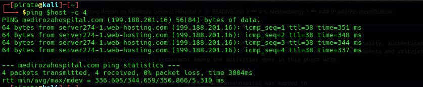
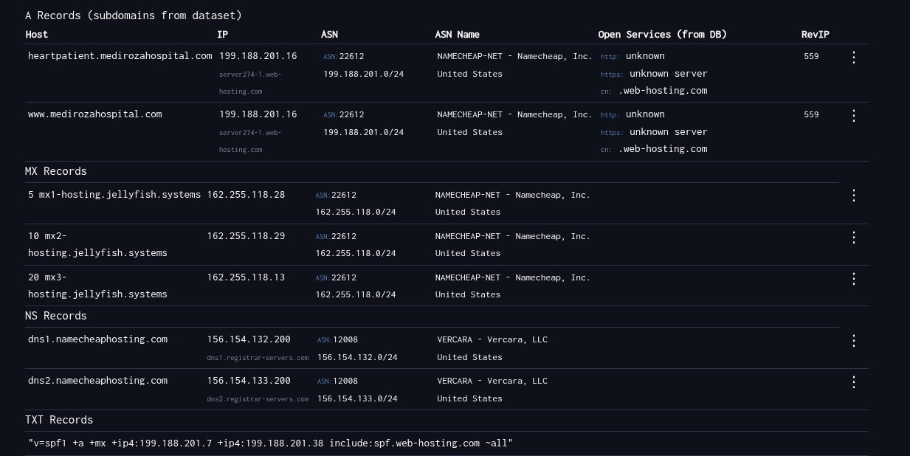
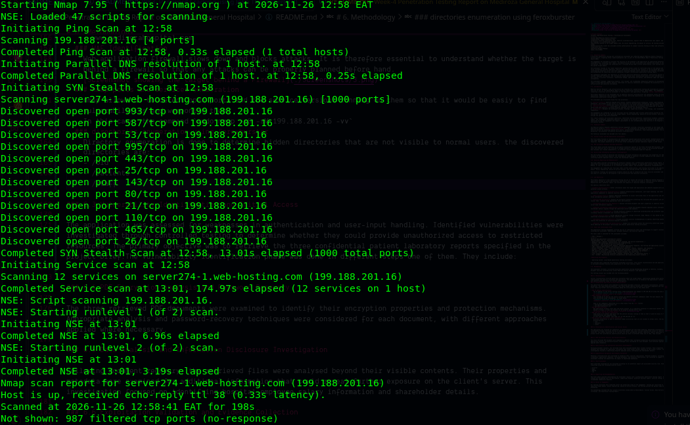
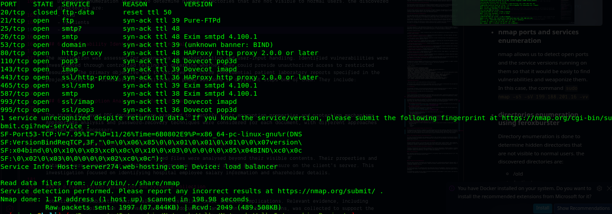
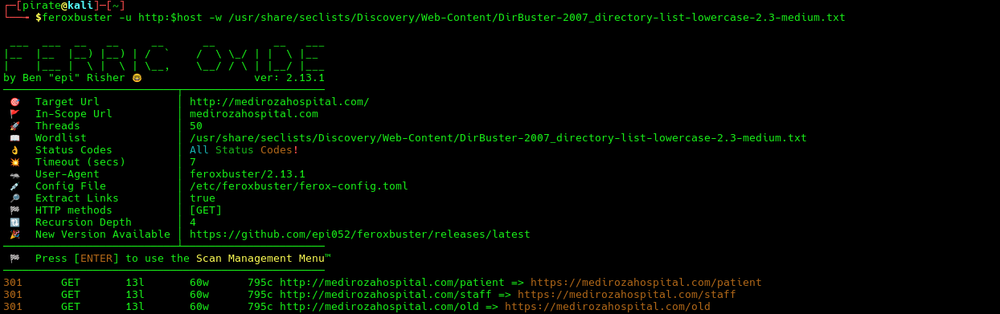
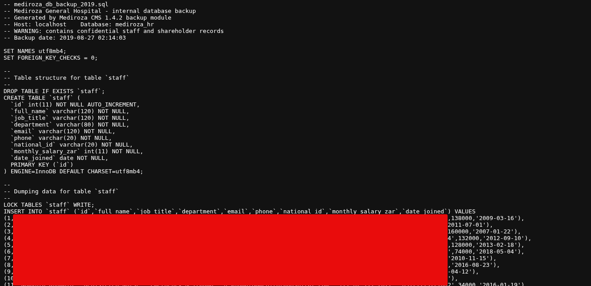
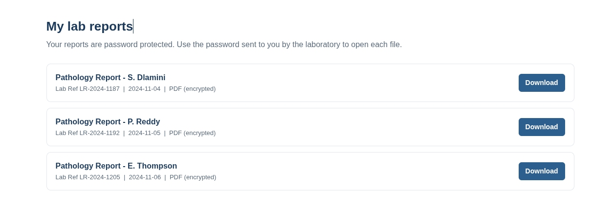
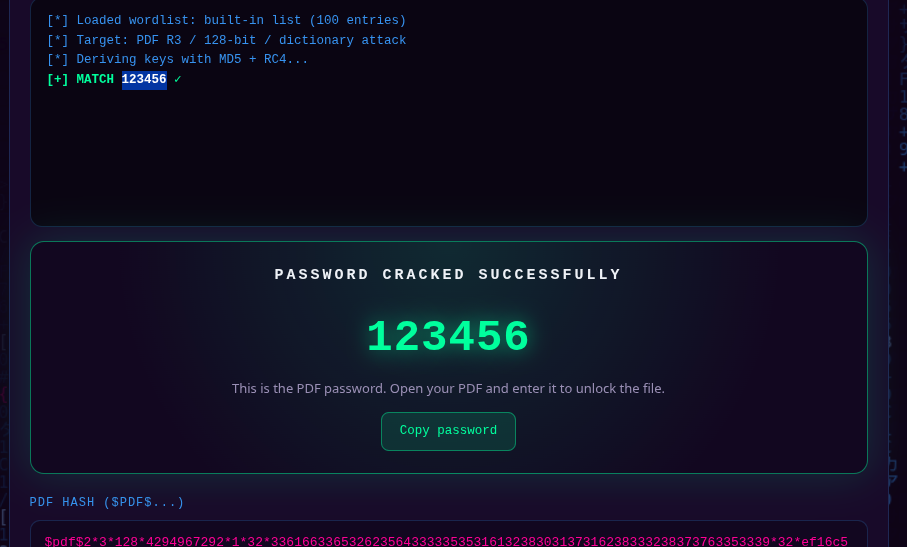
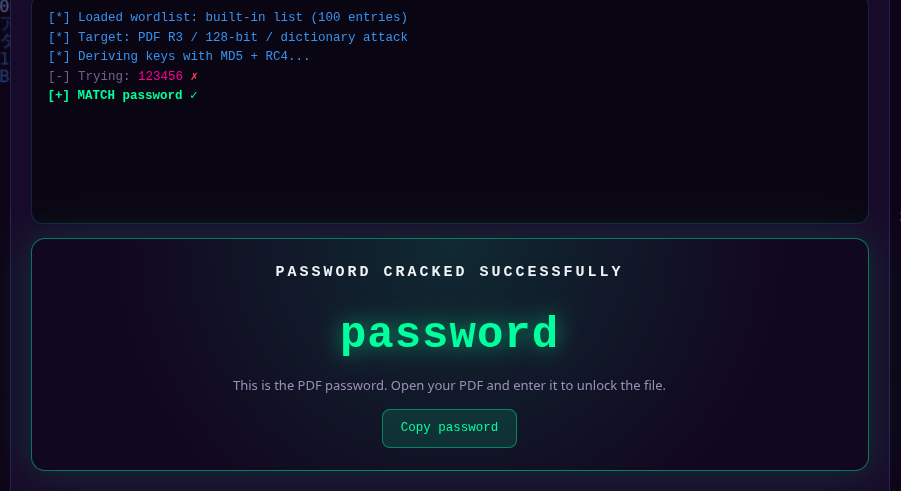
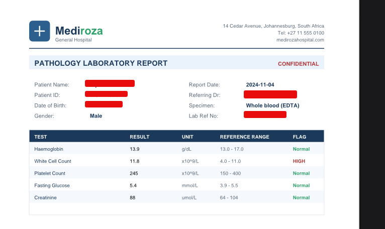

<!-- Penetration Testing Report -->
  
  
  
  
  

# Project Details
|Project Type|Penetration Testing & Vulnerability Assessment|
|---|---|
|Client Name|Mediroza General Hospital|
|Target|https://medirozahospital.com|
|Scope|Full black-box penetration test. Identify vulnerabilities, exploit them to demonstrate real impact, and document all findings in a professional report.|
|RoE|Testing limited to the target domain only. No social engineering. No denial of service. No testing outside agreed scope|
|Authorization|The client has provided written authorisation to conduct security testing on their web infrastructure.|
|Timeline|5 days.|
|Pentester|Njuguna Mwangi|
|Date| 25/11/2026|

---

# 1. Executive Summary
A black-box penetration testing and vulnerability assessment was conducted against Mediroza General Hospital's web infrastructure, targeting https://medirozahospital.com, as part of the NetworkWalks Week 4 Penetration Testing Project (Batch B084).

The engagement was designed to evaluate the security of the hospital's web application by identifying potential vulnerabilities, assessing their impact, and demonstrating the risks associated with unauthorized access to sensitive information. The assessment was conducted over a five-day period under written authorization, with testing restricted to the agreed target domain.

The assessment focused on four major objectives: gaining initial access to restricted areas of the website and retrieving three confidential patient laboratory reports; analysing and recovering the contents of the encrypted PDF files; investigating potential server-side data exposure involving employee salary information and hospital shareholder details; and documenting the identified security weaknesses through a professional penetration testing report.

The engagement highlights the importance of protecting sensitive healthcare information, particularly patient medical records, employee information, and confidential organizational data. Unauthorized access to such information could expose the hospital to privacy violations, reputational damage, operational disruption, and potential legal and regulatory consequences.

The assessment findings, supporting evidence, risk ratings, and recommended remediation measures are documented in this report to help Mediroza General Hospital understand its security weaknesses and strengthen the protection of its web infrastructure and sensitive information.

# 2. Introduction

Mediroza General Hospital's web infrastructure was selected for a penetration testing and vulnerability assessment exercise as part of the NetworkWalks Week 4 Practical Penetration Testing Project (Batch B083). The engagement involved conducting a black-box security assessment of the hospital's web application, targeting **https://medirozahospital.com**.

The primary objective of the assessment was to identify security vulnerabilities and weaknesses within the target application, demonstrate their potential impact through controlled exploitation, and document the findings in a professional penetration testing report.

The assessment was structured around four key milestones:

1. **Initial Access:** Identify exposed entry points, examine authentication mechanisms, assess input-handling weaknesses, and attempt to gain access to restricted areas to retrieve three confidential patient laboratory reports.
2. **Data Extraction:** Analyse and recover the contents of the three retrieved encrypted PDF laboratory reports.
3. **Further Data Exposure:** Investigate the retrieved information and associated file properties to identify potential server-side data exposure, including hospital employee salaries and shareholder details.
4. **Reporting:** Document the assessment process, findings, supporting evidence, risk ratings, and recommendations for remediation.

The engagement was scheduled to run for five days and was conducted under written authorization granted by the client. Testing was restricted to the specified target domain. Social engineering, denial-of-service attacks, and activities outside the agreed scope were prohibited.

This report presents the assessment objectives, identified security weaknesses, exploitation evidence, potential business impact, and recommended remediation measures. Its purpose is to provide a clear understanding of the security risks identified during the engagement and support improvements to the confidentiality and security of the hospital's information systems.

# 3. Technical Summary

The Mediroza General Hospital penetration testing engagement involved a black-box assessment of the target web application hosted at **https://medirozahospital.com**. The assessment was designed to evaluate the application's security posture by examining exposed entry points, authentication mechanisms, input-handling processes, file protection mechanisms, and potential information disclosure vulnerabilities.

The technical assessment was divided into four phases:

**1. Initial Access and Web Application Assessment**

The first phase focused on reconnaissance and identifying exposed application entry points. Authentication mechanisms and user-input handling were examined to identify weaknesses that could potentially allow unauthorized access to restricted resources. The primary objective was to retrieve three confidential patient laboratory reports in PDF format.

**2. PDF Encryption Analysis and Data Recovery**

The second phase involved examining the encryption mechanisms applied to the three retrieved PDF documents. Appropriate tools and wordlists were to be selected to attempt password recovery and gain access to the protected document contents. Each document was treated independently, as different recovery techniques might be required.

**3. Server-Side Information Disclosure Investigation**

The third phase focused on analysing the previously retrieved information and examining file properties for additional evidence of sensitive data exposure. The investigation aimed to identify a further exposure on the client's server involving hospital employee salary records and shareholder details.

**4. Security Reporting and Remediation**

The final phase involved consolidating the technical findings into a professional penetration testing report. Each identified vulnerability was to be documented with supporting evidence, an appropriate severity rating (Critical, High, Medium, or Low), an explanation of its potential business impact, and actionable remediation recommendations.

The engagement was conducted over five days under written authorization, with testing restricted to the specified target domain. Social engineering, denial-of-service attacks, and testing outside the agreed scope were prohibited.

The technical findings and exploitation evidence should be used to establish the final security assessment and determine the level of risk posed to the hospital's web infrastructure and sensitive information.

# 4. Lab Objectives

The primary objective of this penetration testing lab was to assess the security of Mediroza General Hospital's web application through an authorized black-box penetration test. The exercise aimed to identify security weaknesses, demonstrate their potential impact, and evaluate the exposure of sensitive hospital information.

The specific objectives were:

- **Conduct Reconnaissance:** Gather information about the target web application and identify exposed entry points and potential attack surfaces.

-  **Identify Application Vulnerabilities:** Examine authentication mechanisms, user-input handling, and other application components to identify security weaknesses.

-  **Gain Initial Access:** Exploit identified weaknesses to access restricted areas of the application and retrieve three confidential patient laboratory reports.

-  **Analyse PDF Encryption:** Examine the encryption mechanisms protecting the retrieved PDF documents and attempt to recover their contents using appropriate tools and wordlists.

-  **Investigate Sensitive Data Exposure:** Analyse retrieved documents and their properties to identify further server-side information exposure.

-  **Identify Confidential Organizational Information:** Locate and document hospital employee salary information and shareholder details exposed through the identified server-side weakness.

-  **Document Security Findings:** Provide technical evidence of identified vulnerabilities and successful exploitation, including relevant screenshots and recovered information.

-  **Assess Security Risks:** Assign appropriate severity ratings (Critical, High, Medium, or Low) based on the identified vulnerabilities and their potential impact.

-  **Recommend Remediation Measures:** Provide actionable security recommendations to address identified weaknesses and improve the protection of sensitive hospital information.

-  **Maintain Testing Scope and Authorization:** Conduct all activities within the explicitly authorized target domain while adhering to the project restrictions and ethical penetration testing principles.

# 5. Tools and Technologies Used

The penetration testing engagement involved the use of cybersecurity tools and technologies to support reconnaissance, vulnerability assessment, exploitation, document analysis, and security reporting.

The tools used or selected for the assessment included:

| Tool | Purpose |
|---|---|
|Nikto|A web application vulnerability scanner|
|Maltego|OSINT tool for relationships graphing|
| Nmap/rustscan | Network reconnaissance, port scanning, and service enumeration. |
| WhatWeb | Web technology identification and fingerprinting. |
| feroxbuster | Web directory and file enumeration. |
| Burp Suite | Intercepting HTTP requests, analysing application responses, and testing web application vulnerabilities. |
| cURL | Sending HTTP requests and examining server responses. |
| Browser Developer Tools | Inspecting application behaviour, cookies, requests, and responses. |
| Hashcat & John the Ripper | Password recovery and encryption analysis where supported. |
| PDF analysis utilities | Examining PDF document properties, encryption, and metadata. |
| ExifTool | Extracting metadata from retrieved documents and other files. |
| Linux Terminal | Executing assessment commands, managing tools, and analysing results. |
| Git / GitHub | Maintaining technical documentation and organizing project evidence. |

**Operating Environment**

- Operating System: Linux-based penetration testing environment.

The selected tools supported the different assessment activities, from initial reconnaissance and web application testing to encrypted document analysis and preparation of the final security report.

# 6. Methodology

The assessment followed a structured black-box penetration testing methodology designed to identify, validate, and document security vulnerabilities within Mediroza General Hospital's web application.

The testing process was divided into the following phases:

### 6.1 Reconnaissance

Initial reconnaissance involved gathering information about the target domain, identifying exposed entry points, and understanding the publicly accessible web application. The objective was to establish the application's attack surface and identify potential areas for further investigation.
### 6.2 Enumeration and Attack Surface Identification

The identified entry points were examined to understand available resources, application functionality, authentication mechanisms, and input-handling behaviour. This phase helped identify potentially vulnerable components and restricted areas requiring further security assessment.Among the activities done in this phase were:

- ### IP address identification
    The IP address of the server hosting https://medirozahospital was mapped to 199.188.201.16 using the ping utility.
    
    [A screenshot showing a ping to the target](./Screenshots/1.png)
- #### subdomain enumeration
    This allowed me to map out the attack surface and identify different subdomains under the main domains.The subdomains were discovered using `dnsdumpster` as shown below.
    
    [Subdomains enumeration using DNS Dumpster](./Screenshots/2.png)

    Some of the subdomains identified are as shown below from the **A** records.
    - heartpatient.medirozahospital.com	
    - www.medirozahospital.com
- ### WAF Identification
    Web application firewall slows down and blocks attacks. It is therefore essential to understand whether the target is behind a firewall so that any attacks can be properly planned before hand.
    [Screenshot showing the target behind a Firewall](./Screenshots/3.png)
- ### nmap ports and services enumeration
    nmap allows us to detect open ports and the service versions running on them so that it would be easiy to find vulnerabilities and weaponize them.
    In this case, the command `sudo nmap -sS -sV 199.188.201.16 -vv`. The results are shown in the screenshots below.
    
    [A screenshot showing Nmap results Part 1](./Screenshots/4.png)
    
    [A screenshot showing Nmap results Part 2](./Screenshots/5.png)
- ### directories enumeration using feroxburster
    Directory enumeration is done to determine hidden directories that are not visible to normal users. the discovered directories are:
    - /old
    - /patient
    - /staff

    The command used to enumerate the directories is `feroxbuster -u http:$host -w /usr/share/seclists/Discovery/Web-Content/DirBuster-2007_directory-list-lowercase-2.3-medium.txt`. The results are as shown in the screenshot below.
   
    [A screenshot showing forexburster results on the target](./Screenshots/6.png)

### 6.3 Vulnerability Identification and Initial Access

The application was assessed for weaknesses in authentication and user-input handling. Identified vulnerabilities were investigated through controlled testing to determine whether they could provide unauthorized access to restricted resources. The primary objective was to retrieve the three confidential patient laboratory reports specified in the project brief.The vulnerability identification phase was done in different steps one of them. They include:

### 6.4 PDF Encryption Analysis and Password Recovery

The three retrieved PDF documents were examined to identify their encryption properties and protection mechanisms. Appropriate analysis and password-recovery techniques were considered for each document, with different approaches applied where necessary.

### 6.5 Data Analysis and Information Disclosure Investigation

Following document recovery, the retrieved files were analysed beyond their visible contents. Their properties and metadata were examined for additional information that could reveal further exposure on the client's server. This investigation focused on identifying hospital employee salary information and shareholder details.

### 6.6 Exploitation Validation and Evidence Collection

Potential vulnerabilities were evaluated to establish their security implications. Relevant evidence, including screenshots, application responses, retrieved documents, and technical observations, was collected to support the assessment findings and demonstrate the impact of identified weaknesses.

### 6.7 Risk Assessment

Each confirmed vulnerability was evaluated according to its potential impact and associated security risk. Findings were classified using the following severity levels:

- Critical
- High
- Medium
- Low

### 6.8 Reporting and Recommendations

The final phase involved consolidating the assessment results into a professional penetration testing report. Each finding was documented with its description, supporting evidence, potential business impact, severity rating, and recommended remediation measures.

### 6.9 Rules of Engagement

All testing activities were conducted within the authorized scope of the engagement. Testing was restricted to the specified target domain. Social engineering, denial-of-service attacks, and testing outside the agreed scope were prohibited.

The methodology followed the four project milestones established by NetworkWalks: Initial Access, Data Extraction, Attack (Cracking), and Penetration Testing Report.

# 7. Findings and Proof of Exploitation

## F-01: Directory Listing Enabled

**Description:**

Directory listing was identified on the target web application. This misconfiguration allowed directory contents to be displayed through the web server, potentially exposing files and resources that were not intended for public access.

**Security Impact:**

An attacker could enumerate exposed files and directories, discover application resources, identify potentially sensitive information, and obtain information useful for further attacks.However, in this case, the dump of the database was found in the path `/old` where the staff and the shareholders details were exposed. The screenshot below shows a redacted copy of the data.

[A screenshot of staff details from the database](./Screenshots/7.png)

[A screenshot of shareholders details from the database](./Screenshots/7.png)

**Severity:** high.

**Recommendation:**

- Disable directory indexing on the web server.
- Restrict access to sensitive directories.
- Apply appropriate file and directory permissions.
- Ensure confidential files are stored outside publicly accessible web directories.

## F-02: SQL Injection (SQLi)

**Description:**

An SQL injection vulnerability was identified in the web application. The weakness allowed manipulated SQL input to interfere with the application's database queries.The SQLI was present in the patients portal where the username `admin'-- -` and any password allowed a total check of the corrent details.The patient portal became available where patients reports were visible since I had logged in as an `admin`.

**Security Impact:**

Successful exploitation could compromise authentication controls, expose sensitive database records, and provide unauthorized access to privileged application functionality. Depending on the database privileges, the vulnerability could also expose additional organizational information.

**Severity:** Critical.

**Recommendation:**

- Implement parameterized SQL queries and prepared statements.
- Avoid constructing database queries through direct concatenation of user input.
- Apply strict server-side input validation.
- Enforce least-privilege database permissions.
- Use secure password hashing mechanisms.
- Implement appropriate database and application monitoring.

**Evidence:**

[A screenshot showing critical files being accessed](./Screenshots/9.png)

---

## F-03: Exposure of Confidential Patient Laboratory Reports

**Description:**

During the assessment, three confidential patient laboratory reports in PDF format were identified and accessed through the web application.

The exposure demonstrated inadequate protection of sensitive medical documents and raised concerns regarding the application's access control and document confidentiality mechanisms.

**Security Impact:**

Unauthorized access to patient laboratory reports could result in the disclosure of sensitive medical information, privacy violations, reputational damage, and potential regulatory consequences.

**Severity:** High .

**Recommendation:**

- Enforce server-side authorization checks before serving patient documents.
- Store confidential reports outside publicly accessible directories.
- Implement secure, authenticated document delivery.
- Apply access controls based on user roles and permissions.
- Monitor and audit access to sensitive medical records.

**Evidence:**

[A screenshot showing downloaded pdf documents](./Screenshots/10.png)

---

## F-04: Weak Password Protection on PDF Reports

**Description:**

The retrieved PDF laboratory reports were protected using weak passwords. Password recovery analysis demonstrated that the document protection could be defeated, allowing access to the contents of the reports.

This weakness reduced the effectiveness of the encryption controls intended to protect confidential patient information.

**Security Impact:**

Weak document passwords increase the likelihood of unauthorized document access, particularly when files are exposed or obtained by unauthorized individuals.

**Severity:** High.

**Recommendation:**

- Enforce strong, randomly generated document passwords.
- Use modern PDF encryption standards.
- Avoid predictable or reusable passwords.
- Securely distribute and manage document passwords.
- Prioritize server-side access controls instead of relying solely on PDF password protection.

**Evidence:**

# 7. Findings and Proof of Exploitation

| ID | Vulnerability | Description / Evidence | Severity |
|---|---|---|---|
| F-01 | Directory Listing Enabled | The `/old` directory exposed a database dump containing staff and shareholder information. | **CRITICAL** |
| F-02 | SQL Injection (Authentication Bypass) | SQL injection using `admin'-- -` bypassed authentication and granted unauthorized administrative access to the patient portal. | **CRITICAL** |
| F-03 | Exposure of Confidential Patient Laboratory Reports | Three confidential patient laboratory reports were retrieved without adequate access controls, exposing sensitive medical information. | **CRITICAL** |
| F-04 | Weak Password Protection on PDF Reports | Password recovery analysis demonstrated that passwords protecting the retrieved PDF reports could be recovered, exposing their contents. | **HIGH** |

## 7.1 Risk Summary

| Severity | Number of Findings |
|---|---:|
| Critical | 3 |
| High | 1 |
| Medium | 0 |
| Low | 0 |
| Informational | 0 |
| **Total** | **4** |

**Overall Risk Rating: CRITICAL**

The assessment identified significant weaknesses in authentication, access control, directory configuration, and confidential information protection. Immediate remediation is recommended, particularly for the SQL injection vulnerability and unauthorized exposure of organizational and patient information.

## 7.2 Remediation Priority

| Priority | Finding | Recommended Action |
|---|---|---|
| Immediate | F-01 | Disable directory listing and remove exposed database dumps. |
| Immediate | F-02 | Fix SQL injection using parameterized queries and prepared statements. |
| Immediate | F-03 | Restrict access to patient reports through server-side authorization. |
| High | F-04 | Enforce strong document encryption and randomly generated passwords. |
## 8. Recommendations

Based on the findings identified during the penetration testing assessment, the following recommendations are proposed to strengthen the security posture of the web application and protect sensitive organizational and patient information.

1. **Implement Secure Database Interactions:** Eliminate SQL injection vulnerabilities by using parameterized queries, prepared statements, and strict server-side input validation. Avoid dynamically constructing SQL queries using untrusted user input.

2. **Strengthen Access Control Mechanisms:** Implement robust authentication and authorization controls, including role-based access control (RBAC), secure session management, and server-side permission verification for all protected resources.

3. **Secure Sensitive Files and Directories:** Disable directory listing, restrict access to sensitive directories, remove exposed database dumps and backup files, and store confidential resources outside publicly accessible web directories.

4. **Protect Patient Information:** Implement appropriate security controls for patient laboratory reports and other confidential medical records. Ensure that documents can only be accessed by authenticated and authorized users.

5. **Enforce Strong Encryption and Password Policies:** Use modern encryption standards, strong randomly generated passwords, and secure password management procedures. Avoid relying exclusively on PDF password protection to safeguard confidential documents.

6. **Implement Security Monitoring and Logging:** Establish centralized logging and monitoring to detect suspicious activities, unauthorized access attempts, authentication bypasses, and potential data exfiltration. Regularly review security logs.

7. **Maintain Secure Systems and Applications:** Regularly update the operating system, web server, application frameworks, and third-party components. Remove unnecessary services, files, and outdated application resources to minimize the attack surface.

8. **Conduct Regular Security Assessments and Awareness Training:** Perform periodic vulnerability assessments and penetration tests to identify emerging weaknesses. Provide security awareness training to employees, particularly those handling sensitive organizational and patient information.

**Overall Recommendation:** The organization should prioritize remediation of the identified critical and high-severity vulnerabilities, particularly SQL injection and unauthorized exposure of sensitive information. A structured security improvement program should be established to ensure that corrective measures are implemented, verified, and continuously maintained.
# 9. Conclusion

The penetration testing assessment successfully identified and demonstrated several security vulnerabilities within the target web application. A total of four findings were documented, comprising three Critical-severity vulnerabilities and one High-severity vulnerability.

The assessment revealed significant weaknesses in directory configuration, database security, authentication mechanisms, access control, and the protection of confidential information. Successful exploitation of the identified vulnerabilities resulted in the exposure of organizational database records, unauthorized access to the patient portal, and retrieval of confidential patient laboratory reports.

The findings demonstrate that the application's existing security controls are insufficient to adequately protect sensitive organizational and patient information. In particular, the SQL injection vulnerability presents a serious risk because it allows authentication bypass and unauthorized access to protected application functionality.

Overall, the application was assessed to have a **CRITICAL security risk level** based on the vulnerabilities identified and the demonstrated impact of exploitation.

It is strongly recommended that the organization prioritizes remediation of all identified vulnerabilities, implements the security improvements outlined in this report, and conducts follow-up security testing to verify that the weaknesses have been effectively addressed.

The assessment highlights the importance of continuous security monitoring, secure application development practices, proper access control implementation, and regular penetration testing in maintaining the confidentiality, integrity, and availability of organizational information systems.